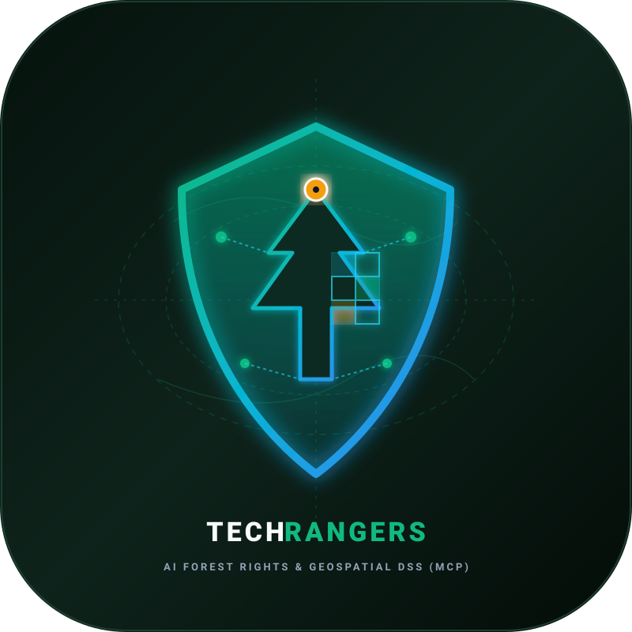
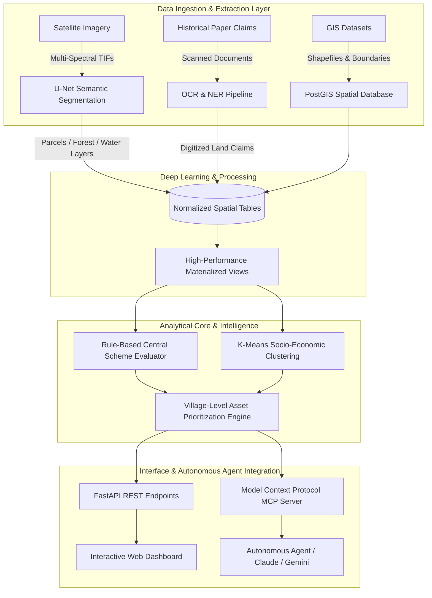

<p align="center">
  
</p>

<h1 align="center">TechRangers</h1>

<p align="center">
  <strong>AI-Driven Forest Rights Act (FRA) Decision Support System with U-Net Satellite Segmentation, PostGIS, &amp; Model Context Protocol (MCP).</strong>
</p>

<p align="center">
  <a href="LICENSE"></a>
  
  
  
  
  <a href="future.md"></a>
</p>

---

## ⚡ System Architecture



---

## 🚀 Key Modules & Engineering Details

### 1. U-Net Semantic Segmentation for Satellite Imagery
*   **Architecture:** PyTorch implementation of the classic U-Net architecture (Encoder-Decoder with Skip Connections).
*   **Segmentation Targets:** Segments multi-spectral satellite imagery into five distinct land classes: **Water Bodies**, **Agricultural Parcels**, **Forest Land**, **Habitations**, and **Barren Land**.
*   **Loss Function & Metrics:** Employs a hybrid loss function combining **Focal Loss** (to counteract severe class imbalance) and **Dice Loss** (to enforce boundary sharpness), evaluated via mean Intersection-over-Union (mIoU).

### 2. Optical Document Ingestion (OCR) & Named Entity Recognition (NER)
*   **Document Digitization:** Extracts structured information from scanned historical FRA paper claims and certificates.
*   **Entity Extraction:** Employs fine-tuned Transformer-based NER models to isolate critical fields: `patta_holder_name`, `village_name`, coordinates, claimed area, and claim status.
*   **Asynchronous Queuing:** Managed by Celery task queues backed by Redis.

### 3. Spatial PostGIS & Materialized View Optimization
*   **Normalized Geospatial Schema:** Relates foundational hierarchies (`states`, `districts`, `villages`) to environmental indices (`forest_data`, `groundwater_data`, `infrastructure_data`).
*   **Pre-computed Spatial Joins:** Rather than executing heavy spatial overlap queries (`ST_Contains`, `ST_DWithin`, `ST_Distance`) on-the-fly, a high-performance **Materialized View (`village_dss_data`)** pre-computes indices including forest cover percentages and nearest water tables.

### 4. Rule-Based + AI-Enhanced DSS
*   **Central Sector Scheme (CSS) Layering:** Evaluates structural indices against policy rules to determine village-level and individual eligibility for programs like **PM-KISAN**, **Jal Jeevan Mission**, **MGNREGA**, and **DAJGUA**.
*   **Asset-based Intervention Priority:** Flags sectors with critically low water indices for targeted borewells under Jal Shakti, backed by empirical GIS data.

### 5. Model Context Protocol (MCP) Integration
*   **Agent-Ready Geospatial API:** Exposes the spatial database, U-Net inference triggers, and DSS algorithms to AI agents via the **Model Context Protocol (MCP)**.
*   **Natural Language Spatial Inquiries:** Enables city administrators to ask geographic questions (e.g., *"Show me all villages in Odisha eligible for Jal Jeevan Mission that have less than 15% forest cover"*), resolved dynamically as structured map overlays.

---

## 📁 Repository Layout

*   `/cv_models`: The semantic segmentation engine, containing the U-Net architecture and training pipelines.
*   `/dss`: The analytical heart of the system, including PostGIS connectors, the rules engine, and MCP integration.
*   `dss_schema.sql` / `dss_materialized_view.sql`: Database definition scripts and index pre-computations.
*   `import_district_boundaries.py` (and related scripts): GIS import scripts parsing shapefiles into PostGIS.
*   `kmeans_clustering.py`: Unsupervised machine learning models clustering villages based on natural and social capital.

---

## 🛠️ Dev Setup & Spatial Ingest

### 1. Install System Dependencies
Ensure you have Python 3.9+ and PostgreSQL (with the PostGIS extension) installed.

### 2. Set Up Virtual Environment & Packages
```bash
git clone https://github.com/seeramsujay/TechRangers.git
cd TechRangers
pip install -r requirements.txt
```

### 3. Initialize the Spatial Database
```bash
psql -h localhost -U postgres -d postgres -f dss_schema.sql
psql -h localhost -U postgres -d postgres -f dss_materialized_view.sql
```

### 4. Import Boundaries
```bash
python import_state_boundaries.py
python import_district_boundaries.py
python import_village_boundaries.py
```

### 5. Launch FastAPI REST & MCP Servers
```bash
python dss/dss_api.py
```
This spins up:
*   **REST API:** `http://localhost:8000` (exposing endpoints like `/api/dss/recommendations`)
*   **MCP Protocol Server:** Running concurrently for AI agents to query the system using natural language.

---

## 🔮 Engineering Roadmap

To explore planned features including GeoSAM zero-shot segmentation, Sentinel-1 SAR cloud-penetrating radar, and decentralized blockchain land title registries, read [future.md](future.md).

---

## 📄 License

This project is licensed under the **MIT License**. See `LICENSE` for details.
